Standard 5-minute ONC spectrograms from the network. More clips on [SoundCloud](https://soundcloud.com/oceannetworkscanada) and [Voices in the Sea](https://voicesinthesea.ucsd.edu/index.html).

::: {.dp-panel}

::: {.callout-note collapse="true"}
## Expand to learn how to read a spectrogram

ONC spectrograms (found in the [Hydrophone Viewer](https://data.oceannetworks.ca/SearchHydrophoneData)) show 5 minutes of sound recorded by our hydrophones. Every plot reads the same way:

* **Left to right:** Time (in minutes)
* **Bottom to top:** Pitch / Frequency (Hz)
* **Color:** Loudness / Sound level (dB)

How to recognize sound patterns by simply looking at a spectrogram:

* **Horizontal lines:** Steady tones, usually from nearby instruments, ship propellers, or electrical interference.
* **Vertical smears of a few seconds:** Noise that spans many pitches at once, like passing ships, weather, earthquakes, or nearby animals.
* **Hard, flat ceilings:** clipping, meaning that the recorded sound was too loud for the sensor.

*Heads up: If you see LPF or HPF in the filename, part of the frequency band was filtered out (see [Data Diversion](10-data-diversion.qmd)).*
:::

:::

*Note that the audio clips have been cropped to the interesting part, but the images show the full 5-min recording.
Also, the sound levels have been processed to improve audio quality. For a better experience, it is recommended to wear noise-cancelling headphones (not earbuds).*

::: {.grid .sound-card-grid}

::: {.g-col-12 .g-col-md-6 .g-col-xl-4}
::: {.sound-card}
::: {.sound-card-body}
<p class="sound-card-title">SONAR</p>
<p class="sound-card-caption">Clayoquot Slope, BC</p>
:::
::: {.sound-card-visual}
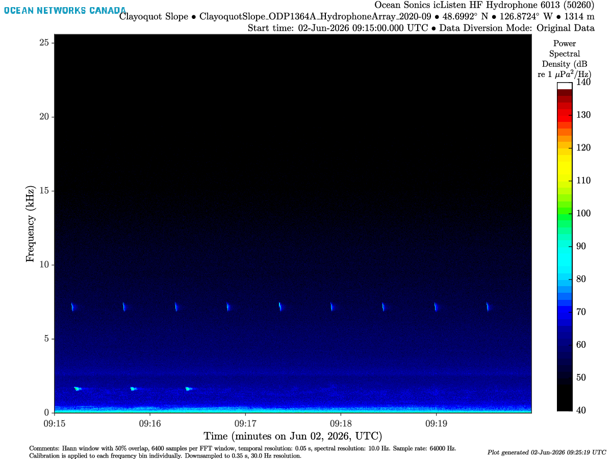{lightbox=true group="sound-gallery"}
:::
```{=html}
<audio class="listen-audio" controls preload="metadata">
  <source src="../sounds/ICLISTENHF6013_20260602T091500.000Z_modified.flac" type="audio/flac">
</audio>
```
:::
:::

::: {.g-col-12 .g-col-md-6 .g-col-xl-4}
::: {.sound-card}
::: {.sound-card-body}
<p class="sound-card-title">Airplane</p>
<p class="sound-card-caption">Conception Bay, NL</p>
:::
::: {.sound-card-visual}
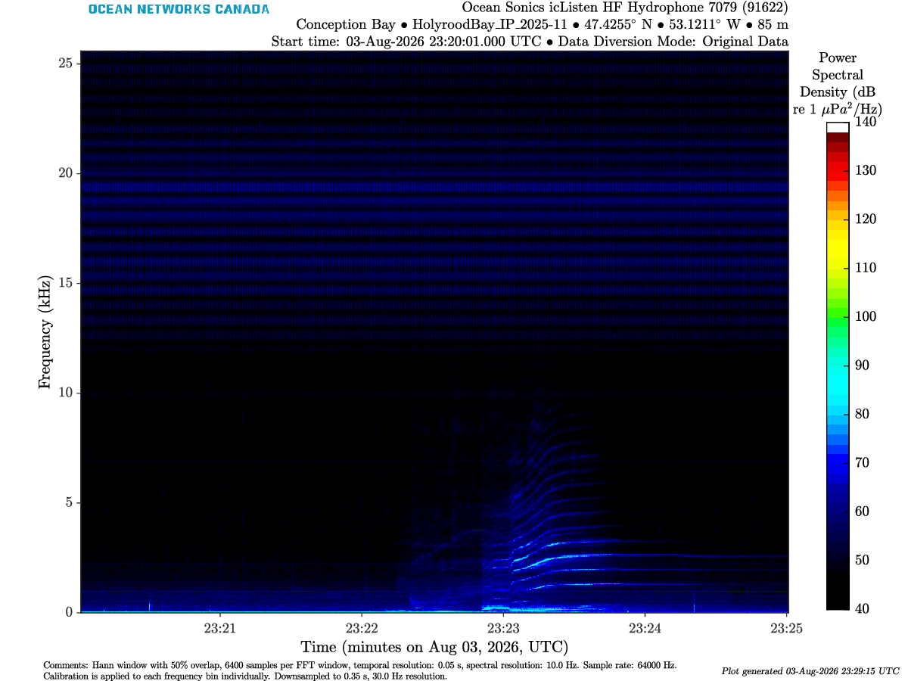{lightbox=true group="sound-gallery"}
:::
```{=html}
<audio class="listen-audio" controls preload="metadata">
  <source src="../sounds/ICLISTENHF7079_20260803T232001.000Z_modified.flac" type="audio/flac">
</audio>
```
:::
:::

::: {.g-col-12 .g-col-md-6 .g-col-xl-4}
::: {.sound-card}
::: {.sound-card-body}
<p class="sound-card-title">Tonals</p>
<p class="sound-card-caption">China Creek, BC</p>
:::
::: {.sound-card-visual}
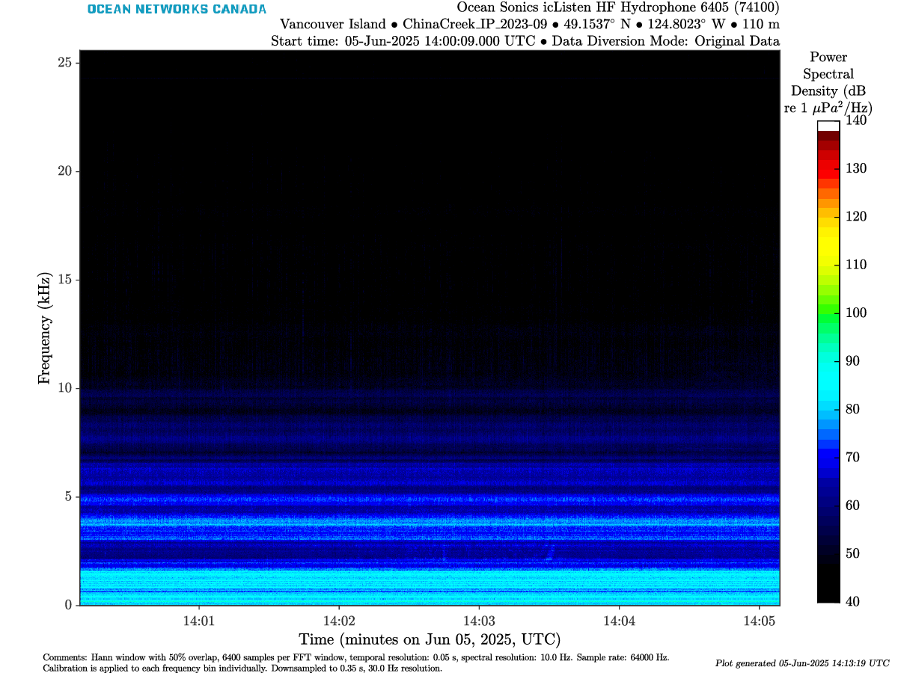{lightbox=true group="sound-gallery"}
:::
```{=html}
<audio class="listen-audio" controls preload="metadata">
  <source src="../sounds/ICLISTENHF6405_20250605T140009.000Z_modified.flac" type="audio/flac">
</audio>
```
:::
:::

::: {.g-col-12 .g-col-md-6 .g-col-xl-4}
::: {.sound-card}
::: {.sound-card-body}
<p class="sound-card-title">Whales</p>
<p class="sound-card-caption">Digby Island, BC</p>
:::
::: {.sound-card-visual}
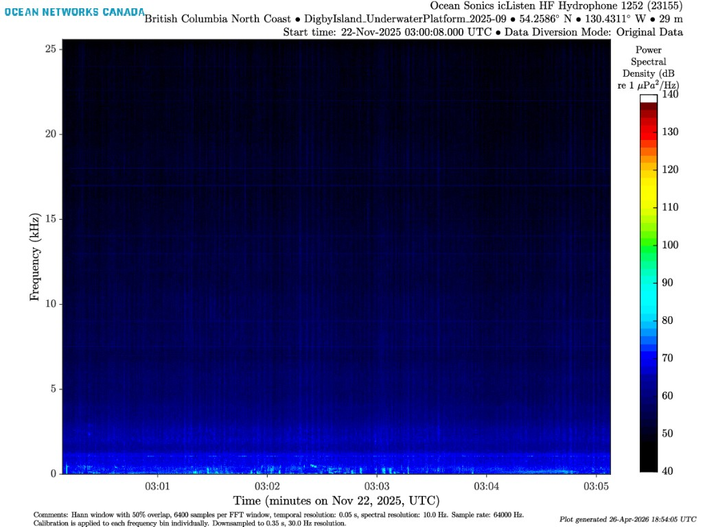{lightbox=true group="sound-gallery"}
:::
```{=html}
<audio class="listen-audio" controls preload="metadata">
  <source src="../sounds/ICLISTENHF1252_20251122T030008.000Z_clip.flac" type="audio/flac">
</audio>
```
:::
:::

::: {.g-col-12 .g-col-md-6 .g-col-xl-4}
::: {.sound-card}
::: {.sound-card-body}
<p class="sound-card-title">Whales</p>
<p class="sound-card-caption">Folger Passage, BC</p>
:::
::: {.sound-card-visual}
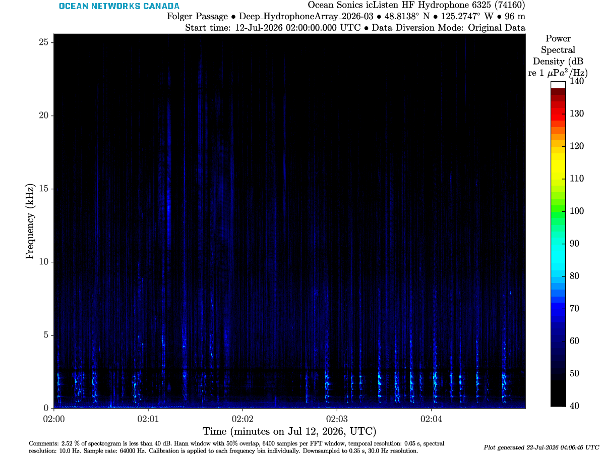{lightbox=true group="sound-gallery"}
:::
```{=html}
<audio class="listen-audio" controls preload="metadata">
  <source src="../sounds/ICLISTENHF6325_20260712T020000.000Z_normalized.flac" type="audio/flac">
</audio>
```
:::
:::

::: {.g-col-12 .g-col-md-6 .g-col-xl-4}
::: {.sound-card}
::: {.sound-card-body}
<p class="sound-card-title">Dolphins</p>
<p class="sound-card-caption">Clayoquot Slope, BC</p>
:::
::: {.sound-card-visual}
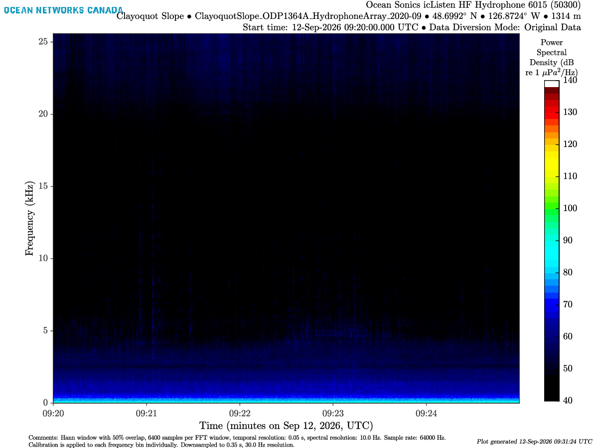{lightbox=true group="sound-gallery"}
:::
```{=html}
<audio class="listen-audio" controls preload="metadata">
  <source src="../sounds/ICLISTENHF6015_20260912T092000.000Z.flac" type="audio/flac">
</audio>
```
:::
:::

::: {.g-col-12 .g-col-md-6 .g-col-xl-4}
::: {.sound-card}
::: {.sound-card-body}
<p class="sound-card-title">Dolphins</p>
<p class="sound-card-caption">Holyrood, NL</p>
:::
::: {.sound-card-visual}
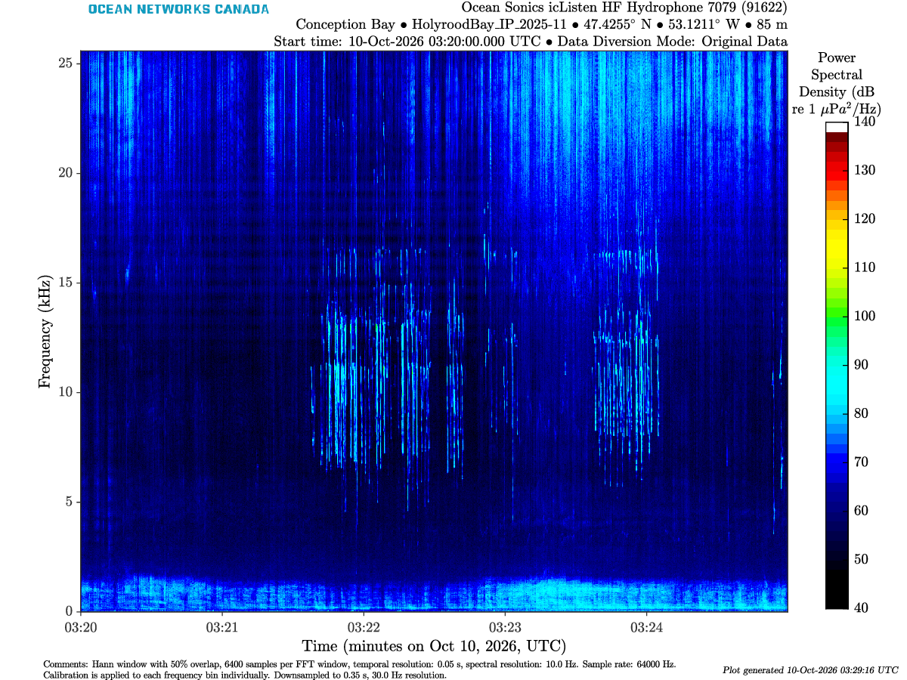{lightbox=true group="sound-gallery"}
:::
```{=html}
<audio class="listen-audio" controls preload="metadata">
  <source src="../sounds/ICLISTENHF7079_20261010T032000.000Z.flac" type="audio/flac">
</audio>
```
:::
:::

::: {.g-col-12 .g-col-md-6 .g-col-xl-4}
::: {.sound-card}
::: {.sound-card-body}
<p class="sound-card-title">Snowmobile</p>
<p class="sound-card-caption">Cambridge Bay, NU</p>
:::
::: {.sound-card-visual}
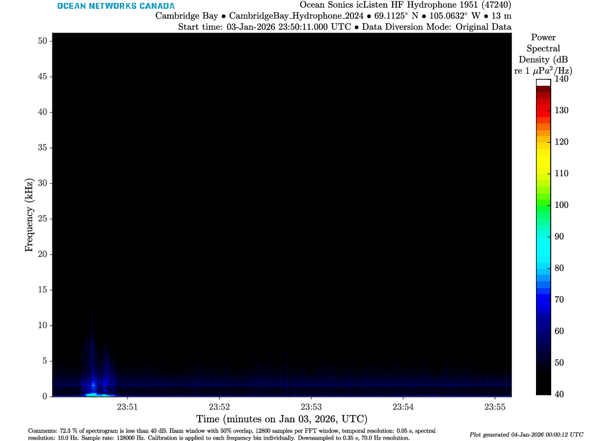{lightbox=true group="sound-gallery"}
:::
```{=html}
<audio class="listen-audio" controls preload="metadata">
  <source src="../sounds/ICLISTENHF1951_20260103T235011.000Z.flac" type="audio/flac">
</audio>
```
:::
:::

::: {.g-col-12 .g-col-md-6 .g-col-xl-4}
::: {.sound-card}
::: {.sound-card-body}
<p class="sound-card-title">Helicopter</p>
<p class="sound-card-caption">Cambridge Bay, NU</p>
:::
::: {.sound-card-visual}
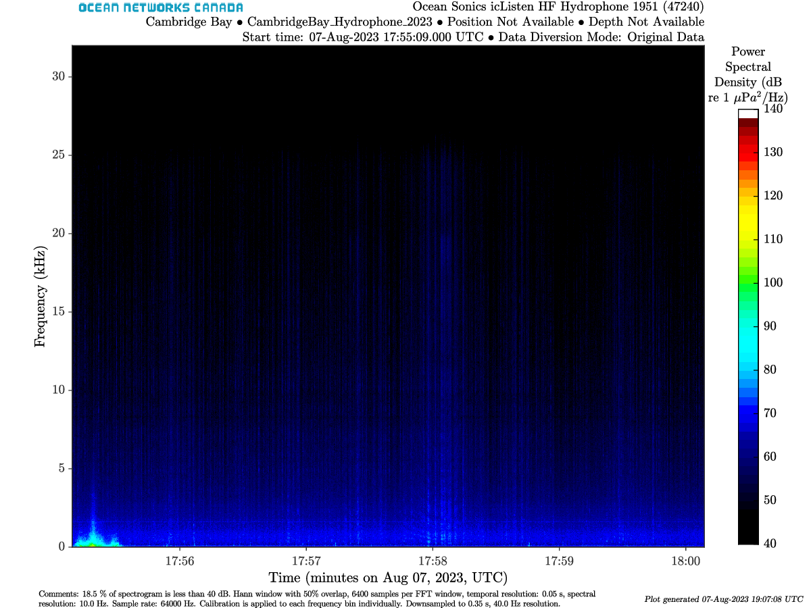{lightbox=true group="sound-gallery"}
:::
```{=html}
<audio class="listen-audio" controls preload="metadata">
  <source src="../sounds/ICLISTENHF1951_20230807T175509.000Z_clip.flac" type="audio/flac">
</audio>
```
:::
:::

::: {.g-col-12 .g-col-md-6 .g-col-xl-4}
::: {.sound-card}
::: {.sound-card-body}
<p class="sound-card-title">Earthquake</p>
<p class="sound-card-caption">Endeavour</p>
:::
::: {.sound-card-visual}
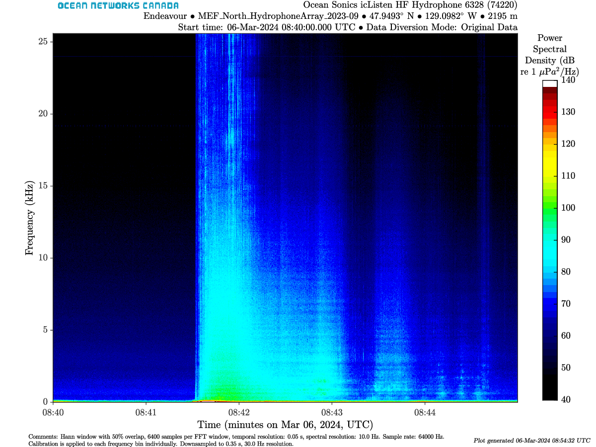{lightbox=true group="sound-gallery"}
:::
```{=html}
<audio class="listen-audio" controls preload="metadata">
  <source src="../sounds/ICLISTENHF6328_20240306T084000.000Z_clip.flac?v=2" type="audio/flac">
</audio>
```
:::
:::

::: {.g-col-12 .g-col-md-6 .g-col-xl-4}
::: {.sound-card}
::: {.sound-card-body}
<p class="sound-card-title">Rain</p>
<p class="sound-card-caption">Folger Passage, BC</p>
:::
::: {.sound-card-visual}
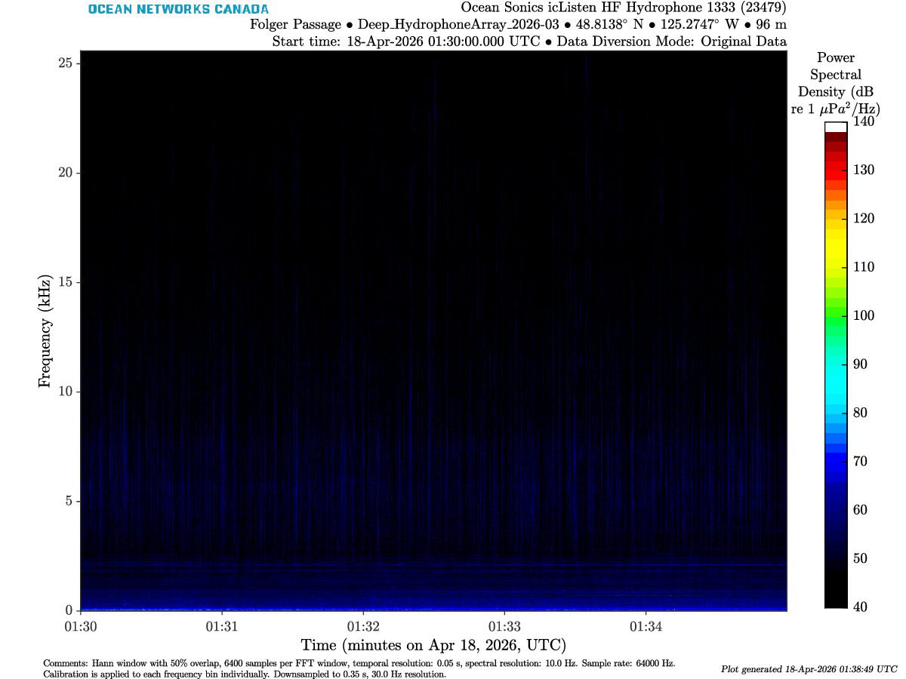{lightbox=true group="sound-gallery"}
:::
```{=html}
<audio class="listen-audio" controls preload="metadata">
  <source src="../sounds/ICLISTENHF1333_20260418T013000.000Z_normalized.flac" type="audio/flac">
</audio>
```
:::
:::

::: {.g-col-12 .g-col-md-6 .g-col-xl-4}
::: {.sound-card}
::: {.sound-card-body}
<p class="sound-card-title">Instrument noise</p>
<p class="sound-card-caption">Cambridge Bay, NU</p>
:::
::: {.sound-card-visual}
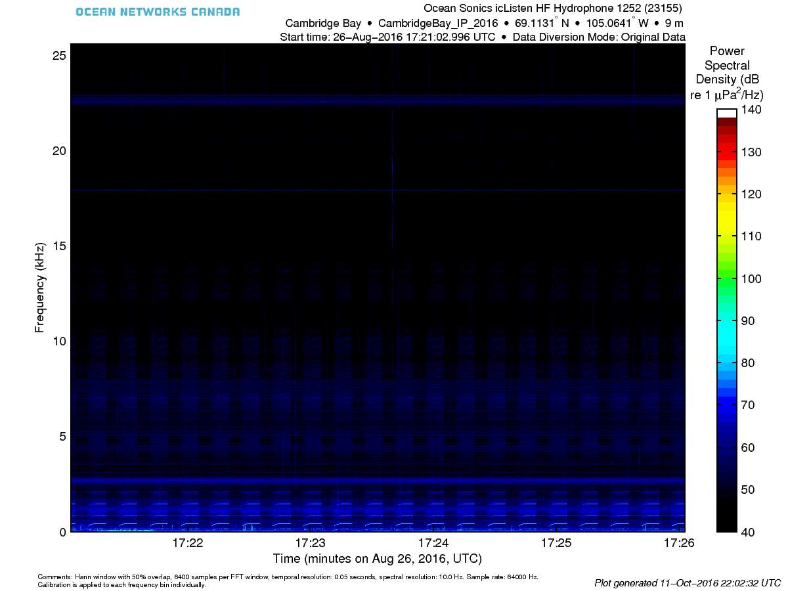{lightbox=true group="sound-gallery"}
:::
```{=html}
<audio class="listen-audio" controls preload="metadata">
  <source src="../sounds/ICLISTENHF1252_20160826T172102.996Z_20160826T172602.996Z.flac" type="audio/flac">
</audio>
```
:::
:::

:::
