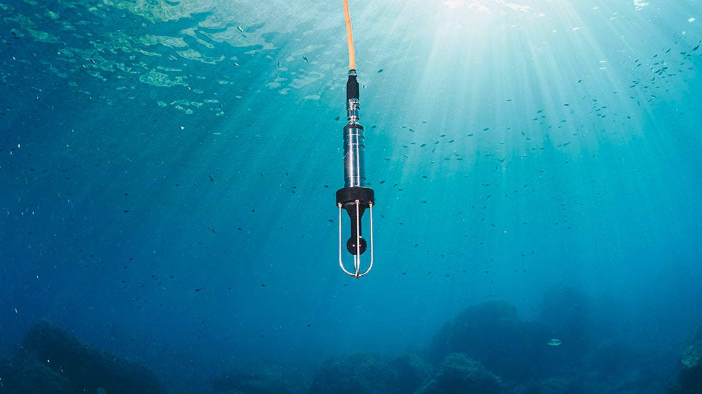

::: {.intro-hero}
{lightbox=true width="100%"}
:::

# October 2026

* [Hydrophone Map](3-hydrophone-map.qmd) now displays the current status.
* [Hydrophone Spectral Data 2.0](https://wiki.oceannetworks.ca/spaces/DP/pages/299139157/204) (`HSD2`, product 204) is now available.
Order it through [Data Search](9-data-access.qmd#data-search) or the [ONC API](9-data-access.qmd#onc-api-advanced).
This product is very similar to the Hydrophone Spectral Data. It differs in the following areas:
	* All products are generated on the fly from source Audio or FFT data
	* Processing has been updated to follow peer reviewed [publications](https://besjournals.onlinelibrary.wiley.com/doi/10.1111/2041-210X.12330) and [standards](https://www.iso.org/standard/82844.html) and provides the most accurate absolute power spectral density for calibrated hydrophones

# August 2026

* Hydrophone handbook release
