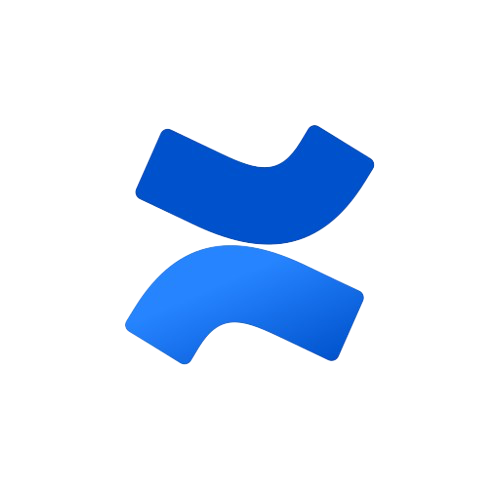
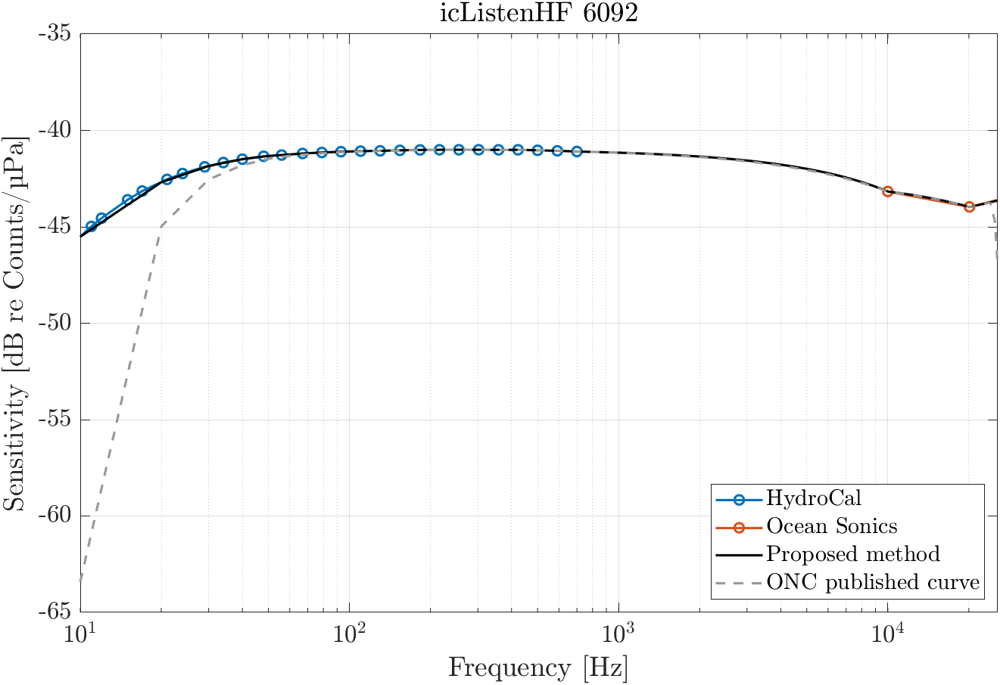
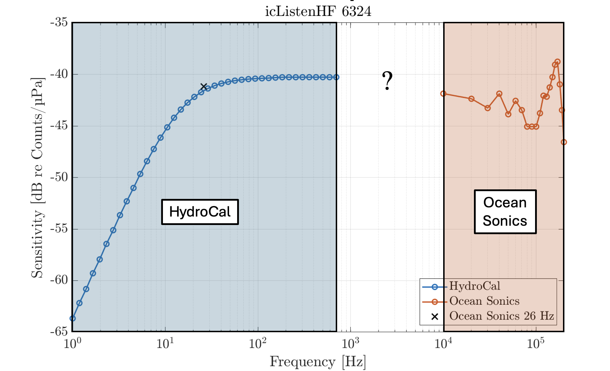

A hydrophone's sensitivity varies across frequencies.
Calibrating hydrophones is essential to ensure accurate conversion of voltage to true underwater sound pressure levels.
At Ocean Networks Canada, every hydrophone is calibrate before it goes in the water, and again when it comes back to examine if the sensitivity has shifted.

# HydroCal

**HydroCal** is Ocean Networks Canada's calibration system, which was developed in-house (see [Biffard et al. (2022)](https://doi.org/10.1109/oceans47191.2022.9976955).
The calibration curve it produces is what used to calibrate the hydrophone data products.

HydroCal measures the low frequencies, from 0.1 to 700 Hz.
Ocean Sonics calibrates the high frequencies of their hydrophones, from 10 kHz to 200 kHz, and also provides a check at 26 Hz.
We use that 26 Hz point to check the HydroCal result.
From 700 Hz to 10 kHz, the curve is filled in between the two.

{lightbox=true}

All the details regarding HydroCal can be found in the [HydroCal user manual](https://internal.oceannetworks.ca/pages/viewpage.action?pageId=216205588&preview=/216205588/216205599/ONC-HydrophoneCalibrationUserManual_22_03_000.pdf).

# Sensitivity curve

The sensitivity curve is included when audio files are downloaded from Oceans 3.0, either in the data portal or through the API.
It applies to that hydrophone for that deployment period.
The curve will soon be available to download on its own, without the audio files.

The file has two columns: frequency (Hz), and sensitivity in dB re counts²/μPa².
Below is an example of the sensitivity curve for icListen HF 6016.

```{python}
#| echo: false
#| fig-cap: "Pre-deployment sensitivity curve for icListen HF 6016, in use since 17 June 2021."
#| lightbox: true

import numpy as np
import matplotlib.pyplot as plt

freq, sens = np.loadtxt(
    "../docs/ICLISTENHF6016_20210617T003000.000Z-hydrophonePreDeploymentCalibration.txt",
    delimiter=",",
    unpack=True,
)

hydro = "#0277b8"
sonics = "#e67e22"

fig, ax = plt.subplots(figsize=(7.2, 3.8), dpi=140)
fig.patch.set_facecolor("white")
ax.set_facecolor("white")
ax.set_xscale("log")
ax.set_xlim(freq.min(), freq.max())
pad = 0.08 * (sens.max() - sens.min())
ax.set_ylim(sens.min() - pad, sens.max() + pad)

ax.axvspan(freq.min(), 700, color=hydro, alpha=0.16, label="HydroCal", zorder=0)
ax.axvspan(10_000, freq.max(), color=sonics, alpha=0.16, label="Ocean Sonics", zorder=0)
ax.plot(freq, sens, color="#1f4e79", linewidth=1.6, zorder=2)

s26 = float(np.interp(26, freq, sens))
ax.scatter([26], [s26], s=36, color="#111111", zorder=3, label="26 Hz check")
ax.annotate(
    "26 Hz",
    xy=(26, s26),
    xytext=(90, s26 - 8),
    fontsize=9,
    color="#111111",
    arrowprops=dict(arrowstyle="-", color="#333333", lw=0.7),
    va="center",
)

ax.set_xlabel("Frequency (Hz)")
ax.set_ylabel("Sensitivity (dB re counts²/μPa²)")
ax.set_xticks([10, 100, 1_000, 10_000, 100_000])
ax.set_xticklabels(["10", "100", "1 kHz", "10 kHz", "100 kHz"])
ax.grid(True, which="major", color="#d0d7e2", linewidth=0.6, zorder=1)
ax.spines["top"].set_visible(False)
ax.spines["right"].set_visible(False)
ax.legend(frameon=False, fontsize=8, loc="lower right")
fig.tight_layout()
plt.show()
```

To convert a value from the file to dB re V/μPa:

$$
S_{V/\mu\mathrm{Pa}} = S_{\text{counts}^2/\mu\mathrm{Pa}^2} + 20\log_{10}(3) - 20\log_{10}(2^{23})
$$

$S_{\text{counts}^2/\mu\mathrm{Pa}^2}$ is the sensitivity in the file.
$20\log_{10}(3)$ is the recorder's $3~\text{V}$ range.
$20\log_{10}(2^{23})$ is the 24-bit recording, with one bit used for the sign.
For most frequencies, the result is about -170 dB re V/μPa.

::: {.callout-note}
Section on tank tests and validation check done just before deployment will be added shortly.
:::

# Resources

```{=html}
<div class="docs-card">
  <div class="docs-card-title">
    
    <span>Documentation</span>
  </div>
  <ul class="docs-card-list">
    <li><a href="https://internal.oceannetworks.ca/pages/viewpage.action?pageId=216205588&preview=/216205588/216205599/ONC-HydrophoneCalibrationUserManual_22_03_000.pdf">HydroCal user manual (PDF)</a></li>
    <li><a href="https://wiki.oceannetworks.ca/spaces/HYD/pages/59015916/Hydrophone+Calibration+System">Hydrophone Calibration System</a></li>
    <li><a href="https://doi.org/10.1109/oceans47191.2022.9976955">Biffard et al. (2022), ONC HydroCal</a></li>
  </ul>
</div>
```

<!-- handbook-draft:


We calibrate because sensitivity is not flat

# Sensitivity

Hydrophones are categorized by their operational frequency bandwidth, which dictates their intended monitoring application: 

| Category | Frequency Range | Target Applications |
| :--- | :--- | :--- |
| **Low-Frequency** | $1\text{ Hz} - 1\text{ kHz}$ | Geophysics, earthquakes, large baleen whales (e.g., Blue, Fin) |
| **Audio-Frequency** | $10\text{ Hz} - 10\text{ kHz}$ | Commercial shipping noise, fish vocalizations, general soundscape |
| **High-Frequency (or broadband)** | $10\text{ Hz} - 200\text{ kHz}$ | Odontocete echolocation (e.g., Orca, Porpoise), acoustic harassment devices |


## Defining Sensitivity

Hydrophone sensitivity ($M_\nu$) measures how efficient the transducer converts underwater sound pressure variations into an electrical output signal.

Quantitatively, sensitivity is defined as the ratio of output voltage ($V$) to input sound pressure ($p$):
$$
M_\nu = \frac{V_{\text{output}}}{p_{\text{input}}} \ \ ; \ \ \text{units:} \left[ \frac{V}{\mu Pa} \right]
$$

## Key factors influencing sensitivity:

- **Hydrophone type**: size, design and choice of material (e.g., piezoelectric compound);
- **Acoustic frequency**: piezoelectric hydrophones have a resonance frequency which depends on the piezoelectric material. Sensitivity is usually good below the resonance frequency and drops rapidly above. 
- **Environmental conditions**: water temperature, salinity and pressure can substantially impact hydrophone sensitivity. It is important to calibrate the instrument relative to those conditions.

## Frequency sensitivity curve

As demonstrated in the Ocean Sonics high-frequency hydrophone, sensitivity is non-uniform across frequencies.
This hydrophone is most efficient at mid-frequencies, and its sensitivity drops below 30 Hz and above 50 kHz.

{lightbox=true}


::: {.callout-important appearance="simple" style="color: #d32f2f; border-left-color: #d32f2f; background-color: #ffebee;"}
## Improvements for this page
* not complete
* annotate the first photo
* there are cool images with annotations in the hydrocal pdf
:::

A hydrophone does not "hear" all frequencies equally.
It might be increadibly sensitive at 10 kHz and deafen by 100 kHz, or vice-versa.
This is why we have LF and HF hydrophones.


# HydroCal

[HydroCal User Manual](https://internal.oceannetworks.ca/pages/viewpage.action?pageId=216205588&spaceKey=MO&title=Hydrocal%2B-%2BHydrophone%2BCalibration%2BSystem&preview=/216205588/216205599/ONC-HydrophoneCalibrationUserManual_22_03_000.pdf)

Ocean Networks Canada Hydrophone Calibration System, known as **ONC HydroCal**, is designed to perform two types of hydrophone calibrations: very low frequency (VLF) calibrations and high frequency (HF) calibrations.

{lightbox=true}

## Ocean Sonics devices
Ocean Sonics calibrates their hydrophones at high frequencies (10 to 200 kHz), as well as at a single low-frequency point 26 Hz.
HydroCal was developped to also calibrate ONC's devices at low-frequencies (0.1 to 700 Hz), measure in-house by engineers at the MTC.
The LF  calibration is validated against Ocean Sonic's 26 Hz.

The mid-range frequencies (700 Hz to 10 kHz) are not calibrated, but the curve is interpolated in between.

## Geospectrum devices
??

# Sensitivity curve
The hydrophone sensitivity curve is what is used to correct the measured sound levels by adding an offset.

{lightbox=true}

Along with downloading hydrophone data, a .txt file containing the sensitivity calibration curve is made readily available.

## Past issues
The ONC calibration curve was errounously calculated at very low frequencies. 
Therefore, the LF data seemed louder than it actually was.
ONC is currently working towards implementing the new corrected calibration curve, and will have to re-generate all the previously archived data products.

# Tank test

Test tanking is a crucial validation step before a hydrophone goes in the ocean.

* Examine for anything loose to prevent leaks, vibrations, things getting away


# Validation

We will be adding an additional validation method for hydrophones to meet the new ISO standard 7605, by using pistonphone to check calibration right before deployment, ideally on the ship.


paper:

* https://ieeexplore.ieee.org/abstract/document/6964377
* https://ieeexplore.ieee.org/abstract/document/7404600
* https://ieeexplore.ieee.org/abstract/document/8084773
* https://ieeexplore.ieee.org/stamp/stamp.jsp?tp=&arnumber=10754545

# Resources

```{=html}
<div style="border: 1px solid rgba(255, 255, 255, 0.2); 
            border-radius: 8px; 
            padding: 16px; 
            background: rgba(255, 255, 255, 0.05); 
            margin-top: 15px;
            backdrop-filter: blur(5px);
            color: white;">

  <div style="display: flex; align-items: center; gap: 12px; margin-bottom: 12px;">
    
    <span style="font-weight: bold; font-size: 1.1em; letter-spacing: 0.3px;">
      Confluence Documentation
    </span>
  </div>

  <ul style="list-style-type: none; padding-left: 36px; margin: 0;">
    

	<li style="margin-bottom: 10px;">
      <a href="https://internal.oceannetworks.ca/spaces/MO/pages/216205588/Hydrocal+-+Hydrophone+Calibration+System?preview=/216205588/216205599/ONC-HydrophoneCalibrationUserManual_22_03_000.pdf" 
         style="color: #82caff; text-decoration: none; font-weight: 500; border-bottom: 1px solid rgba(130, 202, 255, 0.3);">
         HydroCal User Manual
      </a>
    </li>

  </ul>
</div>
```

```{=html}
<div style="border: 1px solid rgba(255, 255, 255, 0.2); 
            border-radius: 8px; 
            padding: 16px; 
            background: rgba(255, 255, 255, 0.05); 
            margin-top: 15px;
            backdrop-filter: blur(5px);
            color: white;">

  <div style="display: flex; align-items: center; gap: 12px; margin-bottom: 12px;">
    
    <span style="font-weight: bold; font-size: 1.1em; letter-spacing: 0.3px;">
      Alfresco Documentation
    </span>
  </div>

  <ul style="list-style-type: none; padding-left: 36px; margin: 0;">
    <li style="margin-bottom: 10px;">
      <a href="https://docs.oceannetworks.ca/share/page/site/corporate-docs/document-details?nodeRef=workspace://SpacesStore/300293c5-17bc-4709-a7e8-459106e15529" 
         style="color: #82caff; text-decoration: none; font-weight: 500; border-bottom: 1px solid rgba(130, 202, 255, 0.3);">
         Hydrophone Calibration System
      </a>
	</li>

  </ul>
</div>
```

-->
