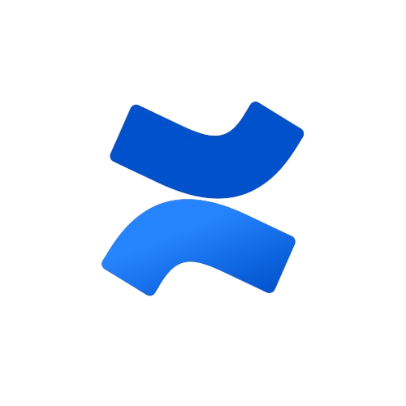

A hydrophone's sensitivity varies across frequencies.
Calibrating hydrophones is essential to ensure accurate conversion of voltage to true underwater sound pressure levels.
At Ocean Networks Canada, every hydrophone is calibrate before it goes in the water, and again when it comes back to examine if the sensitivity has shifted.

# HydroCal

**HydroCal** is Ocean Networks Canada's calibration system, which was developed in-house (see [Biffard et al. (2022)](https://doi.org/10.1109/oceans47191.2022.9976955).
The calibration curve it produces is what used to calibrate the hydrophone data products.

HydroCal measures the low frequencies, from 0.1 to 700 Hz.
Ocean Sonics calibrates the high frequencies of their hydrophones, from 10 kHz to 200 kHz, and also provides a check at 26 Hz.
We use that 26 Hz point to check the HydroCal result.
From 700 Hz to 10 kHz, the curve is filled in between the two.

{lightbox=true}

All the details regarding HydroCal can be found in the [HydroCal user manual](https://internal.oceannetworks.ca/pages/viewpage.action?pageId=216205588&preview=/216205588/216205599/ONC-HydrophoneCalibrationUserManual_22_03_000.pdf).

# Sensitivity curve

The sensitivity curve is included when audio files are downloaded from Oceans 3.0, either in the data portal or through the API.
It applies to that hydrophone for that deployment period.
The curve will soon be available to download on its own, without the audio files.

The file has two columns: frequency (Hz), and sensitivity in dB re counts²/μPa².
Below is an example of the sensitivity curve for icListen HF 6016.

```{python}
#| echo: false
#| fig-cap: "Pre-deployment sensitivity curve for icListen HF 6016, in use since 17 June 2021."
#| lightbox: true

import numpy as np
import matplotlib.pyplot as plt

freq, sens = np.loadtxt(
    "../docs/ICLISTENHF6016_20210617T003000.000Z-hydrophonePreDeploymentCalibration.txt",
    delimiter=",",
    unpack=True,
)

hydro = "#0277b8"
sonics = "#e67e22"

fig, ax = plt.subplots(figsize=(7.2, 3.8), dpi=140)
fig.patch.set_facecolor("white")
ax.set_facecolor("white")
ax.set_xscale("log")
ax.set_xlim(freq.min(), freq.max())
pad = 0.08 * (sens.max() - sens.min())
ax.set_ylim(sens.min() - pad, sens.max() + pad)

ax.axvspan(freq.min(), 700, color=hydro, alpha=0.16, label="HydroCal", zorder=0)
ax.axvspan(10_000, freq.max(), color=sonics, alpha=0.16, label="Ocean Sonics", zorder=0)
ax.plot(freq, sens, color="#1f4e79", linewidth=1.6, zorder=2)

s26 = float(np.interp(26, freq, sens))
ax.scatter([26], [s26], s=36, color="#111111", zorder=3, label="26 Hz check")
ax.annotate(
    "26 Hz",
    xy=(26, s26),
    xytext=(90, s26 - 8),
    fontsize=9,
    color="#111111",
    arrowprops=dict(arrowstyle="-", color="#333333", lw=0.7),
    va="center",
)

ax.set_xlabel("Frequency (Hz)")
ax.set_ylabel("Sensitivity (dB re counts²/μPa²)")
ax.set_xticks([10, 100, 1_000, 10_000, 100_000])
ax.set_xticklabels(["10", "100", "1 kHz", "10 kHz", "100 kHz"])
ax.grid(True, which="major", color="#d0d7e2", linewidth=0.6, zorder=1)
ax.spines["top"].set_visible(False)
ax.spines["right"].set_visible(False)
ax.legend(frameon=False, fontsize=8, loc="lower right")
fig.tight_layout()
plt.show()
```

To convert a value from the file to dB re V/μPa:

$$
S_{V/\mu\mathrm{Pa}} = S_{\text{counts}^2/\mu\mathrm{Pa}^2} + 20\log_{10}(3) - 20\log_{10}(2^{23})
$$

$S_{\text{counts}^2/\mu\mathrm{Pa}^2}$ is the sensitivity in the file.
$20\log_{10}(3)$ is the recorder's $3~\text{V}$ range.
$20\log_{10}(2^{23})$ is the 24-bit recording, with one bit used for the sign.
For most frequencies, the result is about -170 dB re V/μPa.

::: {.callout-note}
Section on tank tests and validation check done just before deployment will be added shortly.
:::

# Resources

```{=html}
<div class="docs-card">
  <div class="docs-card-title">
    
    <span>Documentation</span>
  </div>
  <ul class="docs-card-list">
    <li><a href="https://wiki.oceannetworks.ca/spaces/HYD/pages/59015916/Hydrophone+Calibration+System">Hydrophone Calibration System</a></li>
    <li><a href="https://doi.org/10.1109/oceans47191.2022.9976955">Biffard et al. (2022), ONC HydroCal</a></li>
  </ul>
</div>
```
